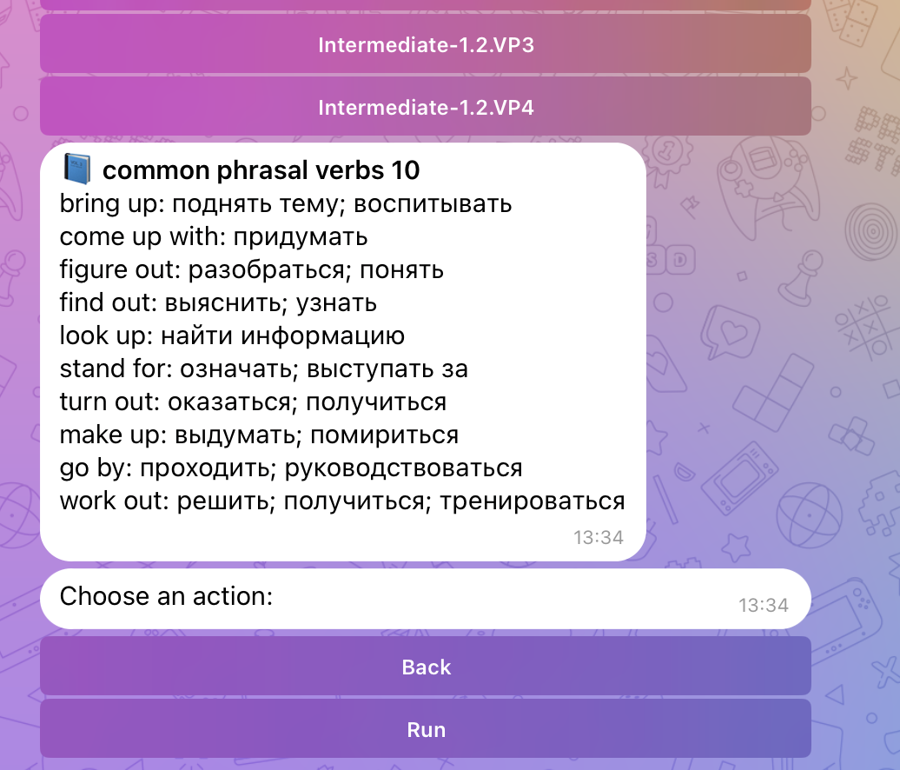
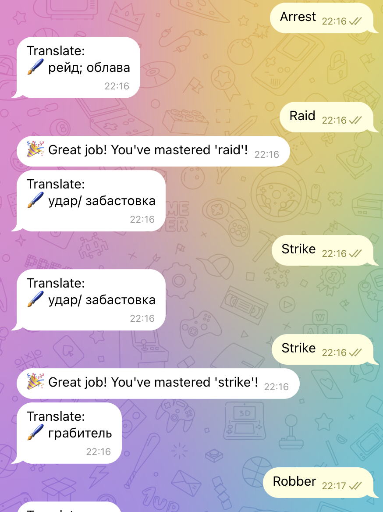
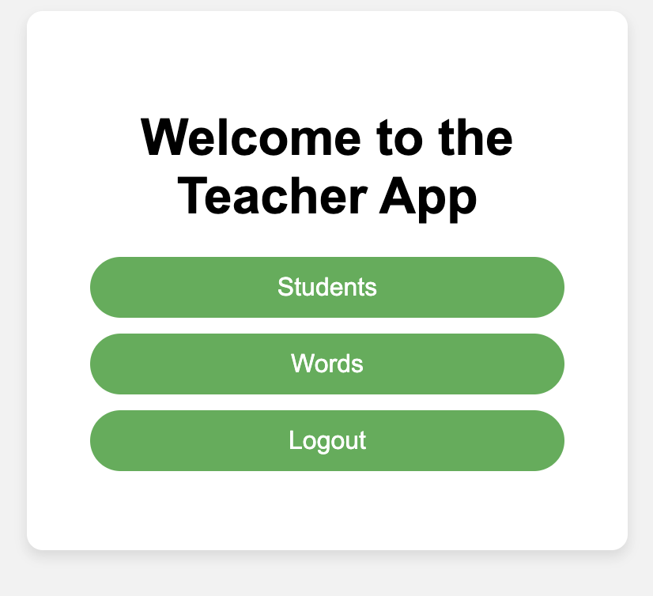
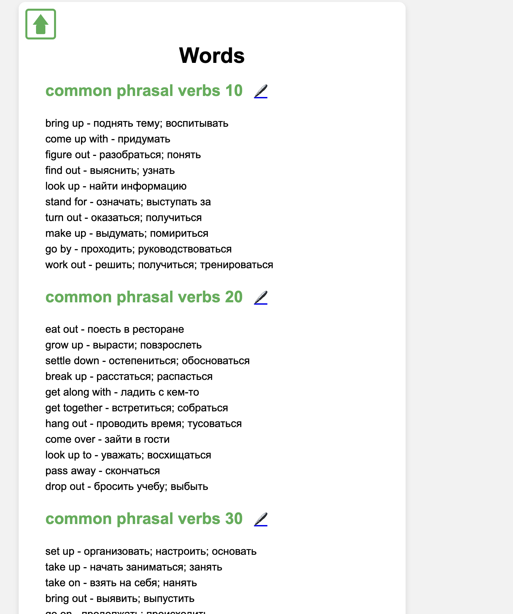
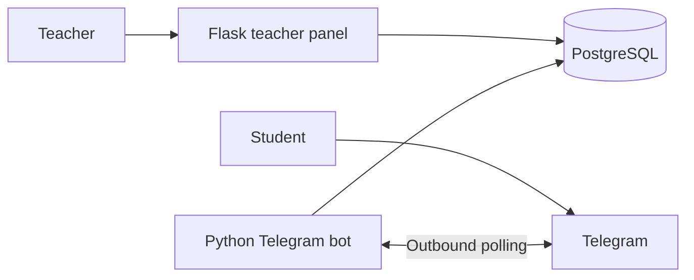

# English4U

[](https://github.com/Kiri7z/english4u-telegram-trainer/actions/workflows/security.yml)

A Telegram vocabulary trainer with a small teacher panel built with Flask and PostgreSQL.

**Status: working pet project, actively developed.** English4U turns a teacher's word lists into translation practice and keeps a student's progress between sessions. The current version is designed for one shared teacher workspace and a single deployment.

## What it does

- Teachers create students, manage units and English/Russian vocabulary, and review results.
- Students enter an access code in Telegram, choose a unit, and practise translation into English.
- Incorrect answers show the correct word. Correct answers build progress.
- Practice covers every remaining word once per shuffled round, avoiding consecutive repeats while alternatives remain.
- A word is mastered after **at least 10 correct answers and at least 2/3 accuracy** and then leaves the practice queue.
- `/words` shows vocabulary and progress without losing the current question. `/stop` ends the game.
- Learning results are stored in PostgreSQL; the current question is held in memory.

## A look at the app

Screenshots of the current application, supplied by the author. Student names and access codes are excluded from this gallery.

<table>
  <tr>
    <td></td>
    <td></td>
  </tr>
  <tr><td><strong>Choose vocabulary</strong></td><td><strong>Practise and master words</strong></td></tr>
  <tr>
    <td></td>
    <td></td>
  </tr>
  <tr><td><strong>Manage students</strong></td><td><strong>Edit vocabulary</strong></td></tr>
</table>

[Answer correction](docs/screenshots/bot-feedback.png) · [Mastered vocabulary](docs/screenshots/bot-progress.png)

## How it fits together



**Stack:** Python 3.12, Flask, Flask-Login, Flask-WTF, SQLAlchemy, python-telegram-bot, PostgreSQL 15, Gunicorn, Docker Compose and GitHub Actions.

The panel and bot have separate database roles. PostgreSQL has no published host port. See [security and current limitations](SECURITY.md).

## Run locally

You need Docker with Compose and a Telegram bot token from BotFather. Use a separate development bot so it does not compete with your already-running bot's polling.

```sh
cp .env.example .env
chmod 600 .env
```

Replace the secret placeholders in `.env`. Generate a separate value for each database password and the Flask key:

```sh
python3 -c 'import secrets; print(secrets.token_urlsafe(48))'
```

Set `TELEGRAM_TOKEN` to your development bot's token, then start the services:

```sh
docker compose config --quiet
docker compose up -d --build
docker compose exec web_teacher_panel python create_teacher.py DemoTeacher
```

The teacher CLI prompts for a password without echoing it. Open <http://localhost:5000>, sign in, create a student and a vocabulary unit, and enter the student's access code after `/start` in Telegram.

Optional vocabulary for an **empty development database**:

```sh
docker compose exec -T postgres psql -U admin -d teacherdb -v ON_ERROR_STOP=1 < scripts_sql/test_values.sql
```

The SQL contains vocabulary only, with no students or access codes. For HTTPS, proxies, backups and existing databases, see [deployment](docs/deployment.md).

## Bot commands

| Command | Purpose |
| --- | --- |
| `/start` | Show the guide or enter an access code. |
| `/units` | Choose a vocabulary unit. |
| `/run` | Practise the selected unit; its Run button does the same. |
| `/words` | Show the active unit without interrupting the question. |
| `/stop` | Stop the current game. |
| `/reset` | End the current game, clear its selected unit and remove your Telegram binding; learning results stay saved. |

## Development and checks

```sh
python3.12 -m venv .venv
. .venv/bin/activate
pip install -r my_flask_app/requirements.txt -r telegram_bot/requirements.txt
python -m unittest discover -s tests -v
```

Tests use in-memory SQLite and mocked Telegram messages; they do not contact Telegram or a production database. GitHub Actions runs regression tests, scans reachable Git history for secrets and audits pinned Python dependencies.

With Node.js 24, also run the student-code generator checks:

```sh
node --test tests/test_student_codes.js
```

The panel generates new 16-character hexadecimal access codes with Web Crypto. Existing student codes and Telegram bindings remain valid.

The next work is tracked in the [roadmap](docs/roadmap.md). Changes use focused branches and pull requests; see [CONTRIBUTING.md](CONTRIBUTING.md).

## License

[MIT](LICENSE).
